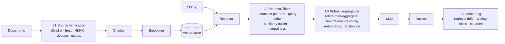

# ragsec: RAG Security and Poisoning Attack Defense

Research codebase for the paper *Evaluating Layered RAG Defenses Against Adaptive Knowledge
Poisoning: A Reproducible Security--Utility Study*. It provides:

- an instrumented retrieval-augmented generation (RAG) pipeline with provenance-aware data models,
- **five knowledge-base poisoning attacks**, including a defense-aware *adaptive* adversary,
- a **four-layer defensive architecture** (ingestion verification, retrieval filtering, robust
  aggregation, anomaly monitoring), each layer independently switchable, and
- an **experiment suite** and report generator for rerunning the studies and rebuilding the
  paper's tables and figures from JSONL results.

## Headline finding

The pinned mock-generator results are corpus-dependent: on SQuAD, the full stack does not lower
adaptive attack-attributable success, and on the toy corpus it raises it. HMAC-authenticated
ingestion brings measured success close to zero under the protected-publisher assumption. A
small local-model follow-up shows the full stack lowering raw adaptive success at a substantial
clean-accuracy cost. The current manuscript and artifact bundle report the pinned evidence;
[`RESULTS.md`](RESULTS.md) preserves an earlier, unpinned report for historical reference.

## Responsible use

This repository contains working implementations of knowledge-base poisoning attacks,
including a defense-aware adaptive adversary. They exist so that defenses can be evaluated
against an adversary that actually tries to evade them, which is the methodological point of
the accompanying paper. They operate on a local corpus you supply and target a local pipeline;
nothing here attacks a third-party system.

Use them on systems you own or are authorised to test. If you deploy RAG in production, the
practical implication is to authenticate a canonical envelope containing each document's
identity, source identity, and text, then verify it at ingestion. This study uses HMAC, a
symmetric message-authentication code; trust scores are assigned by server-side source policy,
not accepted from an uploaded document. Replay prevention and publisher authorization remain
deployment requirements. Every content-based control measured here was evaded by rewriting.

## Architecture



Every layer is a `DefenseLayer` with four optional hooks (`on_ingest`, `on_retrieve`,
`generate`, `on_response`), so layers can be enabled independently for ablations.

### Attacks (`ragsec.attacks`)

| Name | Goal | Mechanism |
|---|---|---|
| `poisoned_rag` | Substitution | Query text prepended to an adversarial statement so it embeds next to the query (PoisonedRAG-style) |
| `trigger_backdoor` | Substitution | Rare trigger phrase in the passage; activated only when the trigger is appended to the query |
| `prompt_injection` | Substitution | Retrievable passage carrying "ignore previous instructions" directives, optional zero-width obfuscation |
| `context_flooding` | Suppression | Many query-matching but answer-free passages crowd genuine evidence out of the top-k |
| `adaptive_poison` | Substitution | **Defense-aware.** Declarative paraphrase, no instruction keywords, natural padding, diluted similarity, spoofed provenance, corroboration across distinct documents |

`adaptive_poison` exposes each evasion technique as an independent flag
(`paraphrase`, `no_directives`, `natural_padding`, `dilute_similarity`, `spoof_source`,
`diversify`), which is what makes the leave-one-out attribution study possible:

```bash
ragsec attack --name adaptive_poison --query "What is the capital of France?" \
  --target Berlin -n 3 --params '{"spoof_source": false}'
```

### Defenses (`ragsec.defenses`)

| Layer | Class | Signals |
|---|---|---|
| L1 | `SourceVerificationLayer` | source allowlist, per-source trust with `min_trust`, HMAC-SHA256 message authentication, content-hash dedupe, per-source quotas |
| L2 | `RetrievalFilterLayer` | `InstructionPatternFilter` (NFKC + invisible-char stripping), `QueryEchoFilter`, `SimilarityOutlierFilter`, `NaturalnessFilter` |
| L3 | `RobustAggregationLayer` | per-passage isolated generation, trust × passage/query coverage² weighted voting, cross-document redundancy bonus, abstain on low margin |
| L4 | `MonitoringLayer` | Jensen–Shannon drift between query windows, benchmark ranking-shift alerts, canary queries |

Each L2 filter reports a **calibrated severity** — its raw statistic divided by its own decision
threshold — and the layer takes the maximum as a single `suspicion` score in a common scale.
Passing `threshold: <τ>` switches the layer from per-filter verdicts to a single sweepable
operating point, which is what traces the detection ROC curve.

## Quickstart

```bash
pip install -e ".[dev]"                # core + tests (fully offline)
pip install -e ".[embeddings,faiss,datasets]"   # sentence-transformers, FAISS, HF datasets

ragsec list
ragsec attack --name adaptive_poison --query "What is the capital of France?" --target Berlin -n 3
ragsec query "What is the capital of France?" --attack poisoned_rag --target Berlin              # undefended
ragsec query "What is the capital of France?" --attack poisoned_rag --target Berlin \
       --config configs/full_defense.yaml                                                        # defended
ragsec monitor --attack context_flooding -n 3
```

`RAGSEC_EMBEDDER=hashing` forces the deterministic offline embedder; the default `auto` uses
sentence-transformers when available and falls back to hashing otherwise.

## Reproducing the paper

```bash
ragsec suite --studies main evasion budget threshold backfill backfill_strict provenance generator \
  --output-dir results/paper-metric-aligned
python scripts/export_paper_artifacts.py results/paper-metric-aligned paper-submission/artifacts \
  --local-model-dir results/paper-local-model-metric-aligned
ragsec figures --results-dir paper-submission/artifacts --output-dir paper-submission \
  --manuscript paper-submission/MainPaper.tex --strict
```

The committed records in `results/paper/` predate dataset revision tracking. New runs use pinned
Hub revisions and a separate output directory, so they cannot be mixed with those archived
records. The SQuAD and HotpotQA commit IDs are recorded in `ragsec/eval/suite.py` and copied
into every new result row. Main-study per-question outcomes are written under
`results/paper-metric-aligned/main_query_records/`; the export step retains hashed cluster IDs, attack
outcomes, and target token-F1 scores for the bootstrap while omitting question and answer text. The report writes its query
intervals to `paper-submission/query_uncertainty.json`; they are conditional on the included
experiment seeds.

`ragsec suite` runs eight offline studies by default. A ninth, real-model confirmation study is
opt-in because it calls a model endpoint; each study writes one JSONL file and can be run alone:

| Study | Question it answers |
|---|---|
| `main` | How much does each layer, and the full stack, reduce attack success on each corpus? |
| `evasion` | Which of the adaptive adversary's six techniques is each layer actually relying on the attacker *not* using? |
| `budget` | How does attack success scale with the number of documents the adversary can insert? |
| `threshold` | What does moving the retrieval filter's operating point cost in false positives and clean accuracy? |
| `backfill` | How much over-retrieval is needed before filtering helps, and what does it cost in latency? |
| `backfill_strict` | The same sweep at an aggressive filter threshold — the only regime where backfill can matter. |
| `provenance` | Do allowlists and trust scores survive a provenance-spoofing adversary, and does HMAC signing recover? |
| `generator` | How much of the measured risk comes from an injection-susceptible generator rather than from retrieval? |
| `confirmation` | Does the headline result hold on real language models rather than the mock generator? **Requires a model endpoint; opt-in.** |

Restrict the grid while iterating:

```bash
ragsec suite --studies main evasion --datasets squad --seeds 0
```

Results are appended as keyed JSON lines. Resume identity includes the full cell configuration,
implementation source fingerprint, runtime package fingerprint, and model/data revisions. A
stale output directory is rejected to prevent mixing runs; use a fresh output directory or
`--no-resume` to replace its study outputs.

### The real-model confirmation study

Every study above uses the deterministic mock generator. That is deliberate: it fixes
generator behaviour exactly, so a change in measured attack success is attributable to the
retrieval pipeline rather than to sampling, and it makes a 612-cell factorial affordable. It is
also the obvious objection, since the mock obeys injected instructions by construction. The
`confirmation` study answers that objection on a reduced grid (SQuAD, 100 queries, one seed,
seven configurations, three attacks) using real models. It measures the four individual layers
(`L1`–`L4`), the full stack, and the signed-ingestion variant alongside the no-defense baseline.
Use `--confirmation-configs` to select a subset while investigating a particular component.

It calls an OpenAI-compatible model endpoint, which may be local or metered, so it is excluded
from a bare `ragsec suite` and must be named:

```bash
export OPENAI_API_KEY=...        # read from the environment, never stored
ragsec suite --studies confirmation --datasets squad --seeds 0
ragsec suite --studies confirmation --datasets squad --seeds 0 --models gpt-4o-mini

# Run selected component ablations with a local Ollama endpoint
ragsec suite --studies confirmation --datasets squad --seeds 0 --models qwen2.5:7b \
  --base-url http://127.0.0.1:11434/v1 --api-key-env RAGSEC_LOCAL_API_KEY \
  --confirmation-configs L1 L3 L4 --output-dir results/qwen-ablation
```

Any OpenAI-compatible `/chat/completions` endpoint works, so the study can run against a
provider with a free tier or against a local server, with no code change:

```bash
# Groq (free tier)
export GROQ_API_KEY=...
ragsec suite --studies confirmation --datasets squad --seeds 0   --base-url https://api.groq.com/openai/v1 --api-key-env GROQ_API_KEY   --models llama-3.3-70b-versatile

# Ollama, local and free; any key value satisfies the client
export OLLAMA_API_KEY=ollama
ragsec suite --studies confirmation --datasets squad --seeds 0   --base-url http://localhost:11434/v1 --api-key-env OLLAMA_API_KEY   --models llama3.1:8b qwen2.5:7b
```

Note that a ChatGPT Plus subscription does not include API access; an API key and its own
billing come from the provider's developer platform.

Completions are cached in `results/paper/llm-cache.sqlite`, keyed by endpoint, model, temperature,
maximum tokens, system prompt and prompt. An interrupted run resumes without paying twice, and
re-running to fix a reporting bug costs nothing when the request is unchanged. Rate limits and
transient server errors are retried with backoff, honouring `Retry-After`.

Two measurement caveats apply to real generators and not to the mock. A verbose model may
mention both the true and the decoy answer in one response, which inflates accuracy and attack
success together; and `max_tokens` is capped at 128, which is ample for extractive answers but
would truncate a discursive one.

Single configurations can still be run directly:

```bash
ragsec evaluate configs/baseline_no_defense.yaml
ragsec evaluate configs/full_defense.yaml
ragsec evaluate configs/full_defense_signed.yaml
for c in configs/ablation_*.yaml; do ragsec evaluate "$c"; done
```

### Reported metrics

- **clean_accuracy**, **abstention_rate** — utility cost on benign traffic
- **attack_success_rate** — the adversary's goal was met
- **conditional_asr** — attack success restricted to queries the *same configuration* answered
  correctly with no adversary present. For the suppression attack the unconditional rate is
  inflated by the pipeline's own errors; this is the attack-attributable part
- **poison_retrieval_rate / poison_used_rate** — whether poison reached the candidate set vs.
  supported the returned answer
- **filter_tpr / filter_fpr** — at the deployed operating point, from ground-truth labels used
  only for scoring
- **detection_auroc / detection_auprc** — threshold-free detector quality over all candidates
- **mean/p95 latency**, decomposed into retrieval, filtering and generation

## The paper

`paper-submission/` holds the revised manuscript, formatted for the *Journal of Information
Security and Applications* (Elsevier):

```
paper-submission/MainPaper.tex    the manuscript (elsarticle class)
paper-submission/MainPaper.pdf    compiled 5p, Times two-column copy
paper-submission/Highlights.tex   Elsevier highlights, uploaded as a separate item
paper-submission/References.bib   bibliography for the manuscript
paper-submission/tables/          generated LaTeX tables and result macros
paper-submission/figures/         generated PDF figures
paper-submission/artifacts/       compact results used to rebuild the report
```

The Elsevier class, numeric bibliography style, and algorithm packages used by this manuscript
are included in `paper-submission/` with their upstream copyright and license notices. A TeX
distribution with the other standard LaTeX dependencies is still required:

```bash
cd paper-submission && pdflatex MainPaper && bibtex MainPaper && pdflatex MainPaper && pdflatex MainPaper
```

The authenticated-ingestion study creates a fresh 256-bit HMAC key at runtime. Never place keys in
YAML configs or committed source.

The manuscript uses Elsevier's `\documentclass[5p,times]{elsarticle}` layout and numeric
citations; wide tables and figures span both columns. JISA's [current scope](https://shop.elsevier.com/journals/journal-of-information-security-and-applications/2214-2126)
is a better fit than *Computers & Security*, whose [stated scope](https://shop.elsevier.com/journals/computers-and-security/0167-4048)
excludes security of AI/ML/LLM systems. The venue is a candidate, not an acceptance prediction.
JISA is Q1 in current SJR/Scopus metrics but Q2 in Journal Citation Reports; confirm which
quartile index the target institution requires before submission.

### Submission history

| Venue | Outcome |
|---|---|
| MDPI *Information* (information-4616315), submitted 23 Sep 2026 | Desk-rejected without review, 26 Sep 2026 |
| *Computers & Security* | Removed from consideration after checking its current scope |
| *Journal of Information Security and Applications* | Current candidate; not submitted |

The MDPI-formatted version and its compiled PDF are in the git history at commit `35304b3`.

### Where the numbers come from

Tables, figures, and aggregate-result macros in the manuscript are regenerated from the compact
artifact bundle. The local-model confirmation table is derived from its included aggregate
JSONL output. Query-level bootstrap records contain hashes rather than source question text and
retain target token-F1 scores as a graded sensitivity measure.

```
results/paper/*.jsonl                     archived raw result records, predating revision tracking
results/paper-metric-aligned/             pinned run outputs (local; raw query text included)
paper-submission/artifacts/*.jsonl        aggregate experiment results
paper-submission/artifacts/query_outcomes.jsonl.gz
                                          hashed, per-query outcomes for cluster intervals
paper-submission/tables/                  generated LaTeX fragments and result macros
paper-submission/figures/                 generated PDF figures
```

To regenerate the paper's tables, figures, and macros from the public artifact bundle, run
`pip install -e '.[paper,datasets]'` followed by
`ragsec figures --results-dir paper-submission/artifacts --output-dir paper-submission
--manuscript paper-submission/MainPaper.tex --strict`, then compile `MainPaper.tex` with the
commands above. The dataset extra is used to regenerate
corpus statistics; it fetches the pinned public snapshots if they are not cached. To export a new run, use
`python scripts/export_paper_artifacts.py results/paper-metric-aligned paper-submission/artifacts
--local-model-dir results/paper-local-model-metric-aligned`. This export omits question text, reference answers,
and model-generated answers while retaining the query-cluster outcomes needed for the reported
bootstrap intervals. The full raw run remains local under `results/`.

## Repository layout

```
ragsec/core        data models, chunker, embedders, vector store, retriever, LLMs, pipeline
ragsec/attacks     attack implementations, including the adaptive adversary
ragsec/defenses    the four defense layers
ragsec/eval        datasets, metrics, experiment runner, experiment suite, report generator
ragsec/cli.py      command-line entry point
configs/           baseline, full defense, signed ingestion, per-layer ablations
paper-submission/  authoritative Elsevier source, generated tables, figures, and artifacts
paper/             previous report-output directory
results/paper/     raw suite output (JSONL)
tests/             pytest suite
```

## Development

```bash
ruff check .
RAGSEC_EMBEDDER=hashing pytest
```

The `MockLLM` used throughout is intentionally naive: it answers extractively from the retrieved
context and, by default, obeys injected instructions. It models a worst-case vulnerable
generator so that attack success is measurable deterministically and offline — the
`generator` study reports the same experiments with instruction-following disabled, which bounds
how much of the measured risk depends on that assumption.
