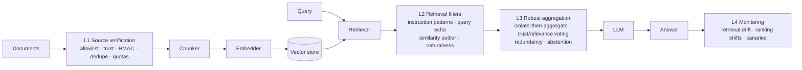

# ragsec: RAG Security and Poisoning Attack Defense

Research codebase for the paper *RAG Security and Poisoning Attack Defense in LLM-Based
Systems: A Layered Architecture and Its Limits Under an Adaptive Adversary*. It provides:

- an instrumented retrieval-augmented generation (RAG) pipeline with provenance-aware data models,
- **five knowledge-base poisoning attacks**, including a defense-aware *adaptive* adversary,
- a **four-layer defensive architecture** (ingestion verification, retrieval filtering, robust
  aggregation, anomaly monitoring), each layer independently switchable, and
- an **experiment suite** and report generator for rerunning the studies and rebuilding the
  paper's tables and figures from JSONL results.

## Headline finding

Against the four static attacks reproduced from the literature, the layered defense works as
that literature predicts. Against an adaptive adversary that simply *rewrites* the payload —
declarative instead of interrogative, assertive instead of imperative, uploaded under a spoofed
trusted source — the retrieval filter's true-positive rate collapses and attack success returns
to undefended levels. Requiring an unforgeable HMAC signature at ingestion is the only control
in the study that survives. See [`RESULTS.md`](RESULTS.md).

## Responsible use

This repository contains working implementations of knowledge-base poisoning attacks,
including a defense-aware adaptive adversary. They exist so that defenses can be evaluated
against an adversary that actually tries to evade them, which is the methodological point of
the accompanying paper. They operate on a local corpus you supply and target a local pipeline;
nothing here attacks a third-party system.

Use them on systems you own or are authorised to test. If you deploy RAG in production, the
practical conclusion of this work is short: sign a canonical envelope containing each
document's identity, source identity, and text at the source, then verify it at ingestion.
Replay prevention and signer authorization remain deployment requirements. Every content-based
control measured here was evaded by rewriting.

## Architecture



Every layer is a `DefenseLayer` with four optional hooks (`on_ingest`, `on_retrieve`,
`generate`, `on_response`), so layers can be enabled independently for ablations.

### Attacks (`ragsec.attacks`)

| Name | Goal | Mechanism |
|---|---|---|
| `poisoned_rag` | Substitution | Query text prepended to an adversarial statement so it embeds next to the query (PoisonedRAG-style) |
| `trigger_backdoor` | Substitution | Rare trigger phrase in the passage; activated only when the trigger is appended to the query |
| `prompt_injection` | Substitution | Retrievable passage carrying "ignore previous instructions" directives, optional zero-width obfuscation |
| `context_flooding` | Suppression | Many query-matching but answer-free passages crowd genuine evidence out of the top-k |
| `adaptive_poison` | Substitution | **Defense-aware.** Declarative paraphrase, no instruction keywords, natural padding, diluted similarity, spoofed provenance, corroboration across distinct documents |

`adaptive_poison` exposes each evasion technique as an independent flag
(`paraphrase`, `no_directives`, `natural_padding`, `dilute_similarity`, `spoof_source`,
`diversify`), which is what makes the leave-one-out attribution study possible:

```bash
ragsec attack --name adaptive_poison --query "What is the capital of France?" \
  --target Berlin -n 3 --params '{"spoof_source": false}'
```

### Defenses (`ragsec.defenses`)

| Layer | Class | Signals |
|---|---|---|
| L1 | `SourceVerificationLayer` | source allowlist, per-source trust with `min_trust`, HMAC-SHA256 signatures, content-hash dedupe, per-source quotas |
| L2 | `RetrievalFilterLayer` | `InstructionPatternFilter` (NFKC + invisible-char stripping), `QueryEchoFilter`, `SimilarityOutlierFilter`, `NaturalnessFilter` |
| L3 | `RobustAggregationLayer` | per-passage isolated generation, trust × relevance² weighted voting, cross-source redundancy bonus, abstain on low margin |
| L4 | `MonitoringLayer` | Jensen–Shannon drift between query windows, benchmark ranking-shift alerts, canary queries |

Each L2 filter reports a **calibrated severity** — its raw statistic divided by its own decision
threshold — and the layer takes the maximum as a single `suspicion` score in a common scale.
Passing `threshold: <τ>` switches the layer from per-filter verdicts to a single sweepable
operating point, which is what traces the detection ROC curve.

## Quickstart

```bash
pip install -e ".[dev]"                # core + tests (fully offline)
pip install -e ".[embeddings,faiss,datasets]"   # sentence-transformers, FAISS, HF datasets

ragsec list
ragsec attack --name adaptive_poison --query "What is the capital of France?" --target Berlin -n 3
ragsec query "What is the capital of France?" --attack poisoned_rag --target Berlin              # undefended
ragsec query "What is the capital of France?" --attack poisoned_rag --target Berlin \
       --config configs/full_defense.yaml                                                        # defended
ragsec monitor --attack context_flooding -n 3
```

`RAGSEC_EMBEDDER=hashing` forces the deterministic offline embedder; the default `auto` uses
sentence-transformers when available and falls back to hashing otherwise.

## Reproducing the paper

```bash
ragsec suite                    # all studies -> results/paper-pinned/*.jsonl (several hours)
ragsec figures                  # tables + figures -> paper/tables, paper/figures
```

The committed records in `results/paper/` predate dataset revision tracking. New runs use pinned
Hub revisions and a separate output directory, so they cannot be mixed with those archived
records. The SQuAD and HotpotQA commit IDs are recorded in `ragsec/eval/suite.py` and copied
into every new result row. Main-study per-question outcomes are written under
`results/paper-pinned/main_query_records/`. Regenerate figures from the new run with
`ragsec figures --results-dir results/paper-pinned`.

`ragsec suite` runs eight offline studies by default. A ninth, real-model confirmation study is
opt-in because it calls a model endpoint; each study writes one JSONL file and can be run alone:

| Study | Question it answers |
|---|---|
| `main` | How much does each layer, and the full stack, reduce attack success on each corpus? |
| `evasion` | Which of the adaptive adversary's six techniques is each layer actually relying on the attacker *not* using? |
| `budget` | How does attack success scale with the number of documents the adversary can insert? |
| `threshold` | What does moving the retrieval filter's operating point cost in false positives and clean accuracy? |
| `backfill` | How much over-retrieval is needed before filtering helps, and what does it cost in latency? |
| `backfill_strict` | The same sweep at an aggressive filter threshold — the only regime where backfill can matter. |
| `provenance` | Do allowlists and trust scores survive a provenance-spoofing adversary, and does HMAC signing recover? |
| `generator` | How much of the measured risk comes from an injection-susceptible generator rather than from retrieval? |
| `confirmation` | Does the headline result hold on real language models rather than the mock generator? **Calls a paid API; opt-in.** |

Restrict the grid while iterating:

```bash
ragsec suite --studies main evasion --datasets squad --seeds 0
```

Results are appended as keyed JSON lines, so an interrupted run resumes without recomputing
finished cells. `--no-resume` forces recomputation.

### The real-model confirmation study

Every study above uses the deterministic mock generator. That is deliberate: it fixes
generator behaviour exactly, so a change in measured attack success is attributable to the
retrieval pipeline rather than to sampling, and it makes a 612-cell factorial affordable. It is
also the obvious objection, since the mock obeys injected instructions by construction. The
`confirmation` study answers that objection on a reduced grid (SQuAD, 100 queries, one seed,
four configurations, three attacks) using real models.

It calls a metered endpoint, so it is excluded from a bare `ragsec suite` and must be named:

```bash
export OPENAI_API_KEY=...        # read from the environment, never stored
ragsec suite --studies confirmation --datasets squad --seeds 0
ragsec suite --studies confirmation --datasets squad --seeds 0 --models gpt-4o-mini
```

Any OpenAI-compatible `/chat/completions` endpoint works, so the study can run against a
provider with a free tier or against a local server, with no code change:

```bash
# Groq (free tier)
export GROQ_API_KEY=...
ragsec suite --studies confirmation --datasets squad --seeds 0   --base-url https://api.groq.com/openai/v1 --api-key-env GROQ_API_KEY   --models llama-3.3-70b-versatile

# Ollama, local and free; any key value satisfies the client
export OLLAMA_API_KEY=ollama
ragsec suite --studies confirmation --datasets squad --seeds 0   --base-url http://localhost:11434/v1 --api-key-env OLLAMA_API_KEY   --models llama3.1:8b qwen2.5:7b
```

Note that a ChatGPT Plus subscription does not include API access; an API key and its own
billing come from the provider's developer platform.

Completions are cached in `results/paper/llm-cache.sqlite`, keyed by model, temperature,
system prompt and prompt. An interrupted run resumes without paying twice, and re-running to
fix a reporting bug costs nothing. Rate limits and transient server errors are retried with
backoff, honouring `Retry-After`.

Two measurement caveats apply to real generators and not to the mock. A verbose model may
mention both the true and the decoy answer in one response, which inflates accuracy and attack
success together; and `max_tokens` is capped at 128, which is ample for extractive answers but
would truncate a discursive one.

Single configurations can still be run directly:

```bash
ragsec evaluate configs/baseline_no_defense.yaml
ragsec evaluate configs/full_defense.yaml
ragsec evaluate configs/full_defense_signed.yaml
for c in configs/ablation_*.yaml; do ragsec evaluate "$c"; done
```

### Reported metrics

- **clean_accuracy**, **abstention_rate** — utility cost on benign traffic
- **attack_success_rate** — the adversary's goal was met
- **conditional_asr** — attack success restricted to queries the *same configuration* answered
  correctly with no adversary present. For the suppression attack the unconditional rate is
  inflated by the pipeline's own errors; this is the attack-attributable part
- **poison_retrieval_rate / poison_used_rate** — whether poison reached the candidate set vs.
  supported the returned answer
- **filter_tpr / filter_fpr** — at the deployed operating point, from ground-truth labels used
  only for scoring
- **detection_auroc / detection_auprc** — threshold-free detector quality over all candidates
- **mean/p95 latency**, decomposed into retrieval, filtering and generation

## The paper

`paper-submission/` holds the manuscript, formatted for **Computers & Security** (Elsevier):

```
paper-submission/MainPaper.tex    the manuscript (elsarticle class)
paper-submission/MainPaper.pdf    compiled 5p, Times two-column copy
paper-submission/Highlights.tex   Elsevier highlights, uploaded as a separate item
paper-submission/References.bib   55 references, 52 with DOIs, all verified Oct 2026
paper-submission/figures/         Fig1.pdf ... Fig12.pdf
```

`elsarticle` ships with TeX Live, MiKTeX and Overleaf, so nothing needs downloading:

```bash
cd paper-submission && pdflatex MainPaper && bibtex MainPaper && pdflatex MainPaper && pdflatex MainPaper
```

The manuscript uses Elsevier's requested `\documentclass[5p,times]{elsarticle}` layout and
numeric Elsevier bibliography style. Wide tables and figures span both columns.
The signed-ingestion study creates a fresh 256-bit key at runtime. Never place signing keys in
YAML configs or committed source.

### Submission history

| Venue | Outcome |
|---|---|
| MDPI *Information* (information-4616315), submitted 23 Sep 2026 | Desk-rejected without review, 26 Sep 2026 |
| Computers & Security | In preparation |

The MDPI-formatted version and its compiled PDF are in the git history at commit `35304b3`.

### Where the numbers come from

Every figure and every value quoted in the manuscript is produced by the experiment suite, not
typed by hand:

```
results/paper/*.jsonl   archived raw result records, 2322 of them, predate revision tracking
results/paper-pinned/   destination for new runs with pinned Hub snapshots and revision metadata
paper/figures/          generated by `ragsec figures`; Fig1..Fig12 are these, renamed
paper/tables/           generated by `ragsec figures`, including every inline result value
paper/body.tex          the working prose source the submission was assembled from
```

`ragsec figures` reads `results/paper-pinned/` by default; use
`ragsec figures --results-dir results/paper` to regenerate the archived results. `ragsec
manuscript` flattens the working sources into `paper/generated/template.tex` as a reference
build. Note that
`MainPaper.tex` has since been edited directly (author list, US spelling, a related-work
comparison table, corrected notation), so it is the authoritative version and the flattener's
output is only a cross-check.

## Repository layout

```
ragsec/core        data models, chunker, embedders, vector store, retriever, LLMs, pipeline
ragsec/attacks     attack implementations, including the adaptive adversary
ragsec/defenses    the four defense layers
ragsec/eval        datasets, metrics, experiment runner, experiment suite, report generator
ragsec/cli.py      command-line entry point
configs/           baseline, full defense, signed ingestion, per-layer ablations
paper/             manuscript sources plus generated tables and figures
results/paper/     raw suite output (JSONL)
tests/             pytest suite
```

## Development

```bash
ruff check .
RAGSEC_EMBEDDER=hashing pytest
```

The `MockLLM` used throughout is intentionally naive: it answers extractively from the retrieved
context and, by default, obeys injected instructions. It models a worst-case vulnerable
generator so that attack success is measurable deterministically and offline — the
`generator` study reports the same experiments with instruction-following disabled, which bounds
how much of the measured risk depends on that assumption.
