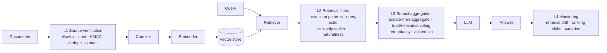

# ragsec: RAG Security and Poisoning Attack Defense

Research codebase for the paper *RAG Security and Poisoning Attack Defense in LLM-Based
Systems: A Layered Architecture and Its Limits Under an Adaptive Adversary*. It provides:

- an instrumented retrieval-augmented generation (RAG) pipeline with provenance-aware data models,
- **five knowledge-base poisoning attacks**, including a defense-aware *adaptive* adversary,
- a **four-layer defensive architecture** (ingestion verification, retrieval filtering, robust
  aggregation, anomaly monitoring), each layer independently switchable, and
- an **experiment suite** that reproduces every number, table and figure in the paper.

## Headline finding

Against the four static attacks reproduced from the literature, the layered defense works as
that literature predicts. Against an adaptive adversary that simply *rewrites* the payload —
declarative instead of interrogative, assertive instead of imperative, uploaded under a spoofed
trusted source — the retrieval filter's true-positive rate collapses and attack success returns
to undefended levels. Requiring an unforgeable HMAC signature at ingestion is the only control
in the study that survives. See [`RESULTS.md`](RESULTS.md).

## Responsible use

This repository contains working implementations of knowledge-base poisoning attacks,
including a defense-aware adaptive adversary. They exist so that defenses can be evaluated
against an adversary that actually tries to evade them, which is the methodological point of
the accompanying paper. They operate on a local corpus you supply and target a local pipeline;
nothing here attacks a third-party system.

Use them on systems you own or are authorised to test. If you deploy RAG in production, the
practical conclusion of this work is short: sign documents at the source and verify the
signature at ingestion. Every content-based control measured here was evaded by rewriting.

## Architecture



Every layer is a `DefenseLayer` with four optional hooks (`on_ingest`, `on_retrieve`,
`generate`, `on_response`), so layers can be enabled independently for ablations.

### Attacks (`ragsec.attacks`)

| Name | Goal | Mechanism |
|---|---|---|
| `poisoned_rag` | Substitution | Query text prepended to an adversarial statement so it embeds next to the query (PoisonedRAG-style) |
| `trigger_backdoor` | Substitution | Rare trigger phrase in the passage; activated only when the trigger is appended to the query |
| `prompt_injection` | Substitution | Retrievable passage carrying "ignore previous instructions" directives, optional zero-width obfuscation |
| `context_flooding` | Suppression | Many query-matching but answer-free passages crowd genuine evidence out of the top-k |
| `adaptive_poison` | Substitution | **Defense-aware.** Declarative paraphrase, no instruction keywords, natural padding, diluted similarity, spoofed provenance, corroboration across distinct documents |

`adaptive_poison` exposes each evasion technique as an independent flag
(`paraphrase`, `no_directives`, `natural_padding`, `dilute_similarity`, `spoof_source`,
`diversify`), which is what makes the leave-one-out attribution study possible:

```bash
ragsec attack --name adaptive_poison --query "What is the capital of France?" \
  --target Berlin -n 3 --params '{"spoof_source": false}'
```

### Defenses (`ragsec.defenses`)

| Layer | Class | Signals |
|---|---|---|
| L1 | `SourceVerificationLayer` | source allowlist, per-source trust with `min_trust`, HMAC-SHA256 signatures, content-hash dedupe, per-source quotas |
| L2 | `RetrievalFilterLayer` | `InstructionPatternFilter` (NFKC + invisible-char stripping), `QueryEchoFilter`, `SimilarityOutlierFilter`, `NaturalnessFilter` |
| L3 | `RobustAggregationLayer` | per-passage isolated generation, trust × relevance² weighted voting, cross-source redundancy bonus, abstain on low margin |
| L4 | `MonitoringLayer` | Jensen–Shannon drift between query windows, benchmark ranking-shift alerts, canary queries |

Each L2 filter reports a **calibrated severity** — its raw statistic divided by its own decision
threshold — and the layer takes the maximum as a single `suspicion` score in a common scale.
Passing `threshold: <τ>` switches the layer from per-filter verdicts to a single sweepable
operating point, which is what traces the detection ROC curve.

## Quickstart

```bash
pip install -e ".[dev]"                # core + tests (fully offline)
pip install -e ".[embeddings,faiss,datasets]"   # sentence-transformers, FAISS, HF datasets

ragsec list
ragsec attack --name adaptive_poison --query "What is the capital of France?" --target Berlin -n 3
ragsec query "What is the capital of France?" --attack poisoned_rag --target Berlin              # undefended
ragsec query "What is the capital of France?" --attack poisoned_rag --target Berlin \
       --config configs/full_defense.yaml                                                        # defended
ragsec monitor --attack context_flooding -n 3
```

`RAGSEC_EMBEDDER=hashing` forces the deterministic offline embedder; the default `auto` uses
sentence-transformers when available and falls back to hashing otherwise.

## Reproducing the paper

```bash
ragsec suite                    # all studies -> results/paper/*.jsonl   (several hours)
ragsec figures                  # tables + figures -> paper/tables, paper/figures
ragsec manuscript               # flatten everything -> "RAG Security Paper/template.tex"
```

`ragsec manuscript` produces the single self-contained submission file MDPI asks for: front
matter, result macros, body, all tables and the bibliography inlined, with figure paths
rewritten to the submission layout. It fails if any em dash survives, since the journal style
adopted here forbids them.

`ragsec suite` runs eight studies; each writes one JSONL file and can be run alone:

| Study | Question it answers |
|---|---|
| `main` | How much does each layer, and the full stack, reduce attack success on each corpus? |
| `evasion` | Which of the adaptive adversary's six techniques is each layer actually relying on the attacker *not* using? |
| `budget` | How does attack success scale with the number of documents the adversary can insert? |
| `threshold` | What does moving the retrieval filter's operating point cost in false positives and clean accuracy? |
| `backfill` | How much over-retrieval is needed before filtering helps, and what does it cost in latency? |
| `backfill_strict` | The same sweep at an aggressive filter threshold — the only regime where backfill can matter. |
| `provenance` | Do allowlists and trust scores survive a provenance-spoofing adversary, and does HMAC signing recover? |
| `generator` | How much of the measured risk comes from an injection-susceptible generator rather than from retrieval? |

Restrict the grid while iterating:

```bash
ragsec suite --studies main evasion --datasets squad --seeds 0
```

Results are appended as keyed JSON lines, so an interrupted run resumes without recomputing
finished cells. `--no-resume` forces recomputation.

Single configurations can still be run directly:

```bash
ragsec evaluate configs/baseline_no_defense.yaml
ragsec evaluate configs/full_defense.yaml
ragsec evaluate configs/full_defense_signed.yaml
for c in configs/ablation_*.yaml; do ragsec evaluate "$c"; done
```

### Reported metrics

- **clean_accuracy**, **abstention_rate** — utility cost on benign traffic
- **attack_success_rate** — the adversary's goal was met
- **conditional_asr** — attack success restricted to queries the *same configuration* answered
  correctly with no adversary present. For the suppression attack the unconditional rate is
  inflated by the pipeline's own errors; this is the attack-attributable part
- **poison_retrieval_rate / poison_used_rate** — whether poison reached the candidate set vs.
  supported the returned answer
- **filter_tpr / filter_fpr** — at the deployed operating point, from ground-truth labels used
  only for scoring
- **detection_auroc / detection_auprc** — threshold-free detector quality over all candidates
- **mean/p95 latency**, decomposed into retrieval, filtering and generation

## Building the paper

```
RAG Security Paper/template.tex   the submission: one self-contained file, nothing \input
RAG Security Paper/figures/       figures referenced by the submission
RAG Security Paper/Definitions/   not in this repository, see below

paper/body.tex          working source for the manuscript text
paper/bibliography.tex  working source for the reference list
paper/tables/           generated by `ragsec figures`
paper/figures/          generated by `ragsec figures` (PDF for submission, PNG for review)
paper/preview.tex       article-class driver for reading the text without the MDPI class
```

Edit the working sources under `paper/`, then re-run `ragsec figures` and
`ragsec manuscript` to rebuild the submission file. Compile it with:

```bash
cd "RAG Security Paper" && pdflatex template && pdflatex template
```

MDPI's LaTeX class, bibliography styles and logos are their copyright and are not
redistributed here. Download the *Information* template from the journal's author pages and
copy its `Definitions/` directory into `RAG Security Paper/` before compiling.

Two passes are enough: the reference list is a literal `thebibliography`, so there is no BibTeX
step. To read the text without the MDPI class:

```bash
cd paper && pdflatex preview.tex && pdflatex preview.tex
```

No number in the manuscript is typed by hand. Tables are generated into `paper/tables/` and
inlined at assembly time, and every result quoted in the prose resolves through a generated
macro, so the text cannot drift away from `results/paper/*.jsonl`.

## Repository layout

```
ragsec/core        data models, chunker, embedders, vector store, retriever, LLMs, pipeline
ragsec/attacks     attack implementations, including the adaptive adversary
ragsec/defenses    the four defense layers
ragsec/eval        datasets, metrics, experiment runner, experiment suite, report generator
ragsec/cli.py      command-line entry point
configs/           baseline, full defense, signed ingestion, per-layer ablations
paper/             manuscript sources plus generated tables and figures
results/paper/     raw suite output (JSONL)
tests/             pytest suite
```

## Development

```bash
ruff check .
RAGSEC_EMBEDDER=hashing pytest
```

The `MockLLM` used throughout is intentionally naive: it answers extractively from the retrieved
context and, by default, obeys injected instructions. It models a worst-case vulnerable
generator so that attack success is measurable deterministically and offline — the
`generator` study reports the same experiments with instruction-following disabled, which bounds
how much of the measured risk depends on that assumption.
