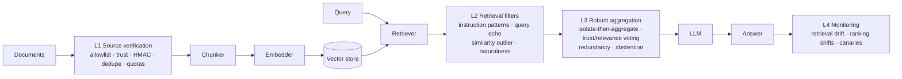

# ragsec: RAG Security and Poisoning Attack Defense

Research codebase accompanying the paper *RAG Security and Poisoning Attack Defense in
LLM-Based Systems*. It provides:

- an instrumented retrieval-augmented generation (RAG) pipeline with provenance-aware data models,
- a suite of **knowledge-base poisoning attacks** for benchmarking,
- a **four-layer defensive architecture** (ingestion verification, retrieval filtering, robust
  aggregation, anomaly monitoring), and
- an **evaluation harness** that reproduces every experiment offline in seconds.

## Architecture



Every layer is a `DefenseLayer` with four optional hooks (`on_ingest`, `on_retrieve`,
`generate`, `on_response`), so layers can be enabled independently for ablations.

### Attacks (`ragsec.attacks`)

| Name | Goal | Mechanism |
|---|---|---|
| `poisoned_rag` | Targeted misinformation | Query text prepended to an adversarial statement so it embeds next to the query (PoisonedRAG-style) |
| `trigger_backdoor` | Dormant hijack | Rare trigger phrase in the passage; activated only when the trigger is appended to the query |
| `prompt_injection` | Instruction override | Retrievable passage carrying "ignore previous instructions" directives, optional zero-width obfuscation |
| `context_flooding` | Availability | Many query-matching but answer-free passages crowd genuine evidence out of the top-k |

### Defenses (`ragsec.defenses`)

| Layer | Class | Signals |
|---|---|---|
| L1 | `SourceVerificationLayer` | source allowlist, per-source trust with `min_trust`, HMAC-SHA256 signatures, content-hash dedupe, per-source quotas |
| L2 | `RetrievalFilterLayer` | `InstructionPatternFilter` (NFKC + invisible-char stripping), `QueryEchoFilter`, `SimilarityOutlierFilter`, `NaturalnessFilter` |
| L3 | `RobustAggregationLayer` | per-passage isolated generation, trust × relevance² weighted voting, cross-source redundancy bonus, abstain on low margin |
| L4 | `MonitoringLayer` | Jensen-Shannon drift between query windows, benchmark ranking-shift alerts, canary queries |

## Quickstart

```bash
pip install -e ".[dev]"            # core + tests (fully offline)
pip install -e ".[embeddings,faiss]"  # optional: sentence-transformers + FAISS

ragsec list
ragsec attack --name poisoned_rag --query "What is the capital of France?" --target Berlin -n 2
ragsec query "What is the capital of France?" --attack poisoned_rag --target Berlin              # undefended
ragsec query "What is the capital of France?" --attack poisoned_rag --target Berlin \
       --config configs/full_defense.yaml                                                       # defended
ragsec monitor --attack context_flooding -n 3
```

`RAGSEC_EMBEDDER=hashing` forces the deterministic offline embedder; the default `auto` uses
sentence-transformers when installed and falls back to hashing otherwise.

## Reproducing the experiments

```bash
ragsec evaluate configs/baseline_no_defense.yaml
ragsec evaluate configs/full_defense.yaml
for c in configs/ablation_*.yaml; do ragsec evaluate "$c"; done
```

Each run writes `results/<name>/summary.csv` plus one JSON file per attack containing every
query record and all monitoring alerts. Reported metrics:

- **clean_accuracy** on the unpoisoned corpus (defense cost on benign traffic)
- **attacked_accuracy** and **attack_success_rate (ASR)** under each attack
- **poison_retrieval_rate / poison_used_rate**: how often poison reaches the candidate set vs. the generator
- **filter_tpr / filter_fpr**: retrieval-filter true/false positive rates using ground-truth labels
- **abstention_rate**, **latency** (mean and p95)

To evaluate on a real dataset and model, point the config at a SQuAD-style HuggingFace dataset
and an OpenAI-compatible endpoint:

```yaml
dataset: {name: hf, path: squad, split: validation, limit: 300}
embedder: {name: auto}
llm: {name: openai, model: gpt-4o-mini, base_url: https://api.openai.com/v1}
```

## Repository layout

```
ragsec/core        data models, chunker, embedders, vector store, retriever, LLMs, pipeline
ragsec/attacks     attack implementations
ragsec/defenses    the four defense layers
ragsec/eval        datasets, metrics, experiment runner, bundled toy corpus
ragsec/cli.py      command-line entry point
configs/           baseline, full defense and per-layer ablation configs
tests/             pytest suite (attacks succeed undefended, are mitigated defended)
```

## Development

```bash
ruff check .
RAGSEC_EMBEDDER=hashing pytest
```

The `MockLLM` used in tests is intentionally naive: it answers extractively from the retrieved
context and obeys injected instructions, modelling a worst-case vulnerable generator so that
attack success is measurable without network access.
